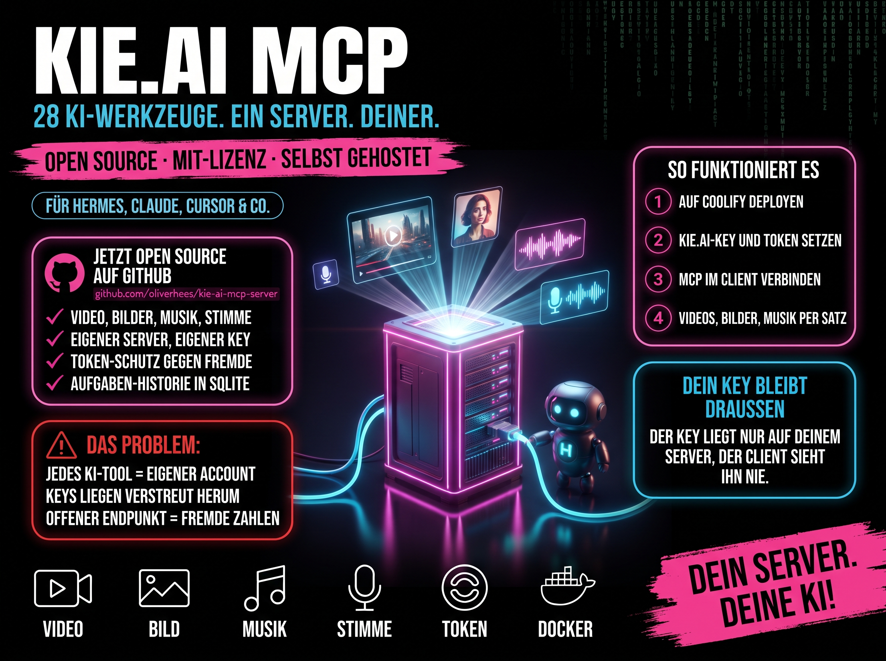

# 🎨 Kie.ai MCP Server — Self-Hosted Edition

[](LICENSE)
[](CHANGELOG.md)
[](https://modelcontextprotocol.io)
[](#-schnellstart)
[](#-self-hosting-mit-coolify-empfohlen)
[](#-was-du-bekommst)

[🇬🇧 English](README.md) · [🇩🇪 Deutsch](README.de.md)



**Ein MCP-Server für State-of-the-Art-KI-Generierung — Video, Bilder, Musik, Audio — auf _deinem eigenen_ Server.**

Das ist eine self-hostbare Variante des Kie.ai-MCP-Servers: alle KI-Tools des Originals (Stand **5.6.2**) plus 8 neue Modelle, mit fertigem **Coolify-Deploy über Streamable HTTP**, damit du ihn auf deiner eigenen Infrastruktur betreiben, von überall erreichen und API-Key wie Daten auf deinem eigenen Server behalten kannst.

> 🆕 **Update November 2026:** Der Fork basiert jetzt auf dem Original 5.6.2 (Monorepo mit MCP-Server, CLI und Agent-Skill). Alte Coolify-Variablen (`MCP_AUTH_TOKEN`, `PORT`, `HOST`) und der alte Tool-Name `gpt_image_2` funktionieren weiter. Details im [CHANGELOG](CHANGELOG.md).

---

## ⚡ Worum geht's

Der ursprüngliche [kie-ai-mcp-server von felores](https://github.com/felores/kie-ai-mcp-server) bringt inzwischen selbst einen Remote-Transport mit. Dieser Fork macht daraus einen **Coolify-Dienst ohne Gefrickel**:

- 🌐 **Remote-Transport (Streamable HTTP)** — über das Netzwerk erreichbar, nicht nur lokal
- 🔐 **Bearer-Token-Auth + Host-Schutz** — nur du verbrauchst deine Credits
- 🐳 **Coolify-Compose** — Domain wird automatisch als erlaubter Host übernommen
- ♻️ **Abwärtskompatibel** — alte Variablen-Namen, alter Volume-Name, Alias `gpt_image_2`
- 💻 **`stdio` bleibt Standard** — lokale Nutzung bricht nicht

Ideal als erster MCP hinter einem self-gehosteten Gateway wie [MetaMCP](https://github.com/metatool-ai/metamcp) oder [MCPJungle](https://github.com/mcpjungle/MCPJungle).

## 🎯 Architektur

```
   Claude Desktop / Cursor / claude.ai
                │  Bearer-Token
                ▼
        MCP-Gateway (MetaMCP)            ← ein Endpoint für alle deine MCPs
                │
                ▼
   ┌─────────────────────────────┐
   │  kie-ai-mcp  (dieser Server)│      ← dein Coolify-Service
   │  Streamable HTTP  →  /mcp    │         • /health für Coolify
   │  SQLite-Task-DB   →  /data   │         • dein KIE_AI_API_KEY
   └─────────────────────────────┘
                │
                ▼
            Kie.ai API  (Veo3, Nano Banana, Suno, …)
```

## 🚀 Schnellstart

Zwei Wege — wähle einen.

| Modus | Wann | Wie |
|-------|------|-----|
| 🐳 **Self-hosted (HTTP)** | Von überall erreichbar, hinter einem Gateway, auf deinem Server | [Coolify-Deploy ↓](#-self-hosting-mit-coolify-empfohlen) |
| 💻 **Lokal (stdio)** | Schnelle lokale Nutzung in einem Client | [npx-Konfiguration ↓](#-lokale-nutzung-stdio) |

---

## 🐳 Self-Hosting mit Coolify (empfohlen)

Direkt aus diesem Repo deployen. Coolify baut das Image und stellt HTTPS bereit.

**1. Neue Ressource** → Coolify → dein Projekt → **+ New Resource → Docker Compose**

**2. Auf dieses Repo zeigen**

| Einstellung | Wert |
|-------------|------|
| Repository | `https://github.com/oliverhees/kie-ai-mcp-server.git` |
| Branch | `main` |
| Compose-File | `docker-compose.coolify.yml` |

**3. Umgebungsvariablen setzen**

```bash
SERVICE_FQDN_KIEAIMCP_3000=kie-mcp.deine-domain.tld   # deine Subdomain — Coolify ergänzt TLS
KIE_AI_API_KEY=dein-kie-ai-api-key                    # von https://kie.ai/api-key
KIE_MCP_HTTP_TOKEN=$(openssl rand -hex 32)            # geheimes Bearer-Token (alt: MCP_AUTH_TOKEN)
```

> ⚠️ **Ohne Token startet der Server nicht.** Er lauscht öffentlich, darum ist das Token Pflicht. Token erzeugen mit `openssl rand -hex 32`. Der alte Name `MCP_AUTH_TOKEN` funktioniert weiter.

> 🛡️ **Host-Schutz:** Der Server nimmt nur Anfragen an deine Domain an. `MCP_ALLOWED_HOSTS` wird automatisch aus der Coolify-Domain gesetzt. Nur bei mehreren Domains selbst setzen (kommagetrennt).

> 💡 **Diese drei reichen.** Eine Callback-URL brauchst du **nicht** — der Server pollt den Task-Status selbst und empfängt keine Callbacks. Lass `KIE_AI_CALLBACK_URL` einfach weg (es gibt einen eingebauten Fallback auf kie.ais eigenen Proxy).

**4. Deploy.** Der Build dauert ~1–3 Min und holt anschließend ein TLS-Zertifikat.

**5. Verifizieren**

```bash
curl https://kie-mcp.deine-domain.tld/health
# → {"status":"ok","transport":"streamable-http","sessions":0,"version":"5.6.2"}
```

Die SQLite-Task-Historie liegt auf dem `/data`-Volume (`kie-ai-data`) und überlebt damit Redeploys — auch das Update von 3.x auf 5.x.

### 🔌 Client anbinden

| Client | URL | Auth |
|--------|-----|------|
| **claude.ai** (Custom Connector) | `https://kie-mcp.deine-domain.tld/mcp` | Bearer-Token |
| **Claude Desktop / Cursor** | gleiche URL (über Streamable HTTP / `mcp-remote`) | `Authorization: Bearer …` |
| **MetaMCP / MCPJungle** | als Streamable-HTTP-Server registrieren, gleiche URL + Token | Bearer-Token |

---

## 💻 Lokale Nutzung (stdio)

Für die schnelle lokale Nutzung bleibt der ursprüngliche stdio-Modus unverändert — einfach zur MCP-Client-Konfiguration hinzufügen:

```json
{
  "mcpServers": {
    "kie-ai": {
      "command": "npx",
      "args": ["-y", "@felores/kie-ai-mcp-server"],
      "env": { "KIE_AI_API_KEY": "dein-api-key" }
    }
  }
}
```

Funktioniert mit Claude Desktop, Cursor, Windsurf, VS Code, Claude Code und mehr.

---

## ⚙️ Konfiguration

### Transport (remote vs. lokal)

| Variable | Standard | Zweck |
|----------|----------|-------|
| `MCP_TRANSPORT` | `stdio` | `stdio` (lokal) oder `http` (remote Streamable HTTP) |
| `MCP_HTTP_PORT` / `MCP_HTTP_HOST` | `3000` / `0.0.0.0` (Docker) | HTTP-Bindung (alt: `PORT` / `HOST`) |
| `KIE_MCP_HTTP_TOKEN` | — | Bearer-Token, **Pflicht bei öffentlichem Betrieb** (alt: `MCP_AUTH_TOKEN`) |
| `MCP_ALLOWED_HOSTS` | Coolify-Domain | Erlaubte Host-Namen, kommagetrennt |
| `MCP_ALLOWED_ORIGINS` | alle | Erlaubte Browser-Origins (alt: `MCP_CORS_ORIGIN`) |

| `KIE_AI_ALLOW_DIRECT_GENERATION` | `true` (Coolify-Datei) | Bild-/Video-/Audio-Tools direkt aufrufbar wie in 3.x. `false` = jede Generierung läuft über `prepare_media_generation` → Freigabe → `submit_media_generation` |

Der MCP-Endpoint ist immer `/mcp` (`MCP_HTTP_PATH` gibt es nicht mehr). Uploads, Tasks und weitere Optionen: siehe [`.env.example`](.env.example) und die [englische README](README.md).

### Kie.ai

| Variable | Standard | Zweck |
|----------|----------|-------|
| `KIE_AI_API_KEY` | — | **Pflicht.** Von [kie.ai/api-key](https://kie.ai/api-key) |
| `KIE_AI_DB_PATH` | `~/.kie-ai/tasks.db` | SQLite-Pfad. In Docker: `/data/tasks.db` (Volume) |
| `KIE_AI_CALLBACK_URL` | — | **Optional — leer lassen.** Der Server pollt den Task-Status selbst und empfängt keine Callbacks. Nur setzen, wenn du einen *eigenen* Webhook-Endpoint zur Weiterverarbeitung betreibst. Leer fällt er automatisch auf kie.ais Proxy zurück. |

### Tool-Filterung

Weniger Rauschen — aktiviere nur die Tools, die du nutzt:

```bash
KIE_AI_ENABLED_TOOLS="nano_banana_image,veo3_generate_video,suno_generate_music"  # Whitelist
KIE_AI_TOOL_CATEGORIES="image,video"                                              # nach Kategorie
KIE_AI_DISABLED_TOOLS="midjourney_generate,runway_aleph_video"                    # Blacklist
```

Priorität: `ENABLED_TOOLS` > `TOOL_CATEGORIES` > `DISABLED_TOOLS` > alle. Utility-Tools (`list_tasks`, `get_task_status`) sind immer aktiv.

---

## 🎨 Was du bekommst

**37 KI-Tools** über Bild, Video und Audio — Veo 3, Nano Banana, Suno, ElevenLabs, ByteDance Seedance 2.5/Seedream, Qwen, GPT Image 2.5 (`gpt_image`, Alias `gpt_image_2`), Flux 2, Flux Kontext, Wan 3.0 + Wan Image, Gemini Omni, OmniHuman, HappyHorse, Hailuo, Kling 3.0, Midjourney, Runway Aleph, Topaz, Recraft, Ideogram und mehr. **Neu im Fork:** Kling 3.0 Omni (`kling_omni_video`), Kling 4.0 (`kling_4_video`), PixVerse V6 Max (`pixverse_video`), Vidu Q4 (`vidu_video`), Topaz Video-Upscale (`topaz_upscale_video`), Gemini TTS (`gemini_tts`), ElevenLabs Dialogue v3 (`elevenlabs_dialogue`), FLUX 3 Klein (`flux3_klein_image`) sowie Nano Banana Pro und 2.1 in `nano_banana_image`. Dazu Planung mit Preis-Vorschau (`prepare_media_generation` / `submit_media_generation`) und `wait_for_task`. Jedes Tool erkennt den Modus automatisch (Generieren / Bearbeiten / Hochskalieren in einem).

**→ [Komplette Tool-Referenz](docs/TOOLS.md)** · [Datenbank & Tasks](docs/DATABASE.md) · [Admin-Konfiguration](docs/ADMIN.md)

## 🔑 Kern-Features

- 🌐 **Remote-fähig** — Streamable-HTTP-Transport mit Sessions
- 🔐 **Auth eingebaut** — Bearer-Token + Host-Schutz, offener `/health` für Healthchecks
- 🐳 **Coolify-/Docker-Deploy** — Multi-Stage-Image, läuft ohne root, persistentes DB-Volume
- 🎯 **Ein API-Key** für alle Modelle · 🔄 **SQLite-Task-Tracking**, das Neustarts überlebt
- 🧠 **Smarte Kostenkontrolle** — wählt standardmäßig die günstigste Stufe, außer du forderst Qualität

## 🆘 Fehlerbehebung

**`401` auf `/mcp`** — dein Client sendet kein `Authorization: Bearer <Token>`, oder das Token passt nicht.

**`403 Invalid Host header`** — die Domain fehlt in `MCP_ALLOWED_HOSTS`. Setze sie in Coolify (z. B. `kie-mcp.deine-domain.tld`).

**Container startet nicht: „KIE_MCP_HTTP_TOKEN … is required“** — kein Token gesetzt. `KIE_MCP_HTTP_TOKEN` (oder alt `MCP_AUTH_TOKEN`) in Coolify eintragen.

**Coolify-Build schlägt fehl** — prüfe, ob der Compose-Pfad `docker-compose.coolify.yml` und der Branch korrekt ist. 

**`/health` antwortet direkt nach dem Deploy nicht** — der Server braucht ~1–4 s zum Hochfahren (große Tool-Registry). Der `start_period` des Healthchecks deckt das ab; einfach einen Moment warten.

---

## 🙏 Credits

- **[felores/kie-ai-mcp-server](https://github.com/felores/kie-ai-mcp-server)** — der ursprüngliche MCP-Server, CLI und alle KI-Tools. Diese Edition ergänzt nur den Coolify-/Kompatibilitäts-Layer.
- **[Kie.ai](https://kie.ai)** — die vereinheitlichte KI-Generierungs-API.
- **[Model Context Protocol](https://modelcontextprotocol.io)** — der offene Standard, auf dem das aufbaut.

## 👋 Über uns — Aiianer

Self-Hosting-Layer gebaut und gepflegt von **Oliver Hees** (alias **Aiianer**) — wir bauen Tools, Kurse und Content für die deutschsprachige KI-Builder-Community.

Wenn dir das beim Self-Hosting deiner eigenen KI-Tools geholfen hat, sag am besten so danke — komm vorbei:

[](https://skool.com/aiianer)
[](https://youtube.com/@aiianer)
[](https://aiianer.de)

- 🎓 **[Skool Community](https://skool.com/aiianer)** — Kurse, Deep-Dives und eine Community von Buildern
- 📺 **[YouTube](https://youtube.com/@aiianer)** — Tutorials und Walkthroughs
- 🌐 **[Website](https://aiianer.de)** — alles andere

## 📄 Lizenz

[MIT](LICENSE) — mach damit, was du willst, aber gib mir nicht die Schuld, wenn's kaputtgeht.

Wenn du es forkst oder etwas darauf aufbaust, ist ein Backlink zu diesem Repo oder ein Shoutout an [@aiianer](https://aiianer.de) willkommen, aber nicht erforderlich. Original-Tools © [felores](https://github.com/felores/kie-ai-mcp-server).

---

**Made with 💛 in Germany · [aiianer.de](https://aiianer.de)**
