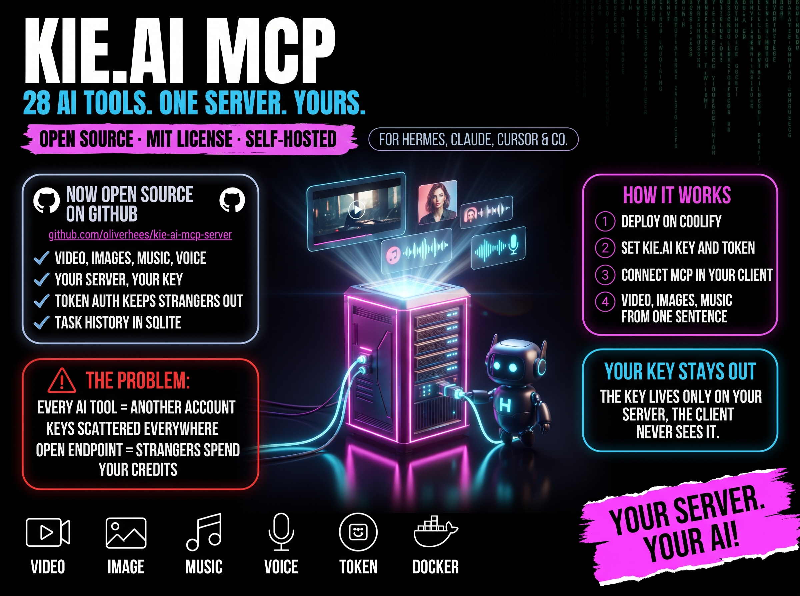

# 🎨 Kie.ai MCP Server — Self-Hosted Edition

[](LICENSE)
[](CHANGELOG.md)
[](https://modelcontextprotocol.io)
[](#-quick-start)
[](#-self-host-on-coolify-recommended)
[](#-what-you-get)

[🇬🇧 English](README.md) · [🇩🇪 Deutsch](README.de.md) · [🇪🇸 Español (upstream)](README.es.md)



**One MCP server for state-of-the-art AI generation — video, images, music, audio — running on _your own_ server.**

This is a self-hostable build of the Kie.ai MCP server: **37 AI tools** (everything from upstream 5.6.2 plus 8 new models), with a ready-made **Coolify deploy over Streamable HTTP** so you can run it on your own infrastructure, reach it from anywhere, and keep your data and your API key on your own box.

> 🆕 **November 2026 update:** the fork now builds on upstream [felores/kie-ai-mcp-server](https://github.com/felores/kie-ai-mcp-server) **5.6.2** (monorepo with MCP server, CLI and agent skill) and adds **Kling 3.0 Omni, Kling 4.0, PixVerse V6, Vidu Q4, Topaz video upscale, Gemini TTS, ElevenLabs Dialogue v3, FLUX 3 Klein, Nano Banana Pro and 2.1**. Your 3.x Coolify setup keeps working: old variable names (`MCP_AUTH_TOKEN`, `PORT`, `HOST`), the old volume and the old `gpt_image_2` tool name are all still accepted. Details in the [CHANGELOG](CHANGELOG.md).

---

## ⚡ What This Is

The original [kie-ai-mcp-server by felores](https://github.com/felores/kie-ai-mcp-server) is a fantastic MCP server and CLI, and now ships its own remote transport. This fork turns it into a **no-fuss Coolify service** and adds more models:

- 🌐 **Remote Streamable HTTP transport** — reachable over the network, not just locally
- 🔐 **Bearer-token auth + Host check** — so only you can spend your credits
- 🐳 **Coolify compose** — your Coolify domain becomes the allowed host automatically
- 🆕 **8 extra models** — Kling 3.0 Omni & 4.0, PixVerse V6, Vidu Q4, Topaz video, Gemini TTS, ElevenLabs Dialogue v3, FLUX 3 Klein
- ♻️ **Backwards compatible** — old env names, old volume, `gpt_image_2` alias; `stdio` stays the default

Perfect as the first MCP behind a self-hosted gateway like [MetaMCP](https://github.com/metatool-ai/metamcp) or [MCPJungle](https://github.com/mcpjungle/MCPJungle).

## 🎯 Architecture

```
   Claude Desktop / Cursor / claude.ai
                │  Bearer token
                ▼
        MCP Gateway (MetaMCP)            ← one endpoint for all your MCPs
                │
                ▼
   ┌─────────────────────────────┐
   │  kie-ai-mcp  (this server)  │      ← your Coolify service
   │  Streamable HTTP  →  /mcp    │         • /health for Coolify
   │  SQLite task DB   →  /data   │         • your KIE_AI_API_KEY
   └─────────────────────────────┘
                │
                ▼
            Kie.ai API  (Veo3, Nano Banana, Suno, …)
```

## 🚀 Quick Start

Two ways to run it — pick one.

| Mode | When | How |
|------|------|-----|
| 🐳 **Self-hosted (HTTP)** | Reachable from anywhere, behind a gateway, on your own server | [Coolify deploy ↓](#-self-host-on-coolify-recommended) |
| 💻 **Local (stdio)** | Quick local use in one client | [npx config ↓](#-local-use-stdio) |

---

## 🐳 Self-Host on Coolify (recommended)

Deploy straight from this repo. Coolify builds the image and provisions HTTPS for you.

**1. New resource** → Coolify → your project → **+ New Resource → Docker Compose**

**2. Point it at this repo**

| Setting | Value |
|---------|-------|
| Repository | `https://github.com/oliverhees/kie-ai-mcp-server.git` |
| Branch | `main` |
| Compose file | `docker-compose.coolify.yml` |

**3. Set environment variables**

```bash
SERVICE_FQDN_KIEAIMCP_3000=kie-mcp.your-domain.tld   # your subdomain — Coolify adds TLS
KIE_AI_API_KEY=your-kie-ai-api-key                   # from https://kie.ai/api-key
KIE_MCP_HTTP_TOKEN=$(openssl rand -hex 32)           # secret bearer token (old name MCP_AUTH_TOKEN works too)
```

> ⚠️ **No token, no start.** The server listens publicly, so it refuses to start without a bearer token. Generate one with `openssl rand -hex 32`. The old name `MCP_AUTH_TOKEN` still works.

> 🛡️ **Host check:** the server only answers requests for your domain. `MCP_ALLOWED_HOSTS` is filled from the Coolify domain automatically; set it yourself only for extra domains (comma-separated).

> 💡 **These three are all you need.** You do **not** need a callback URL — the server polls task status itself and has no callback receiver. Leave `KIE_AI_CALLBACK_URL` unset (there's a built-in fallback to kie.ai's own proxy).

**4. Deploy.** The build takes ~1–3 min, then Coolify fetches a TLS cert.

**5. Verify**

```bash
curl https://kie-mcp.your-domain.tld/health
# → {"status":"ok","transport":"streamable-http","sessions":0,"version":"5.6.2"}
```

The SQLite task history lives on the `/data` volume (`kie-ai-data`), so it survives redeploys — including the upgrade from 3.x to 5.x.

### 🔌 Connect a client

| Client | URL | Auth |
|--------|-----|------|
| **claude.ai** (Custom Connector) | `https://kie-mcp.your-domain.tld/mcp` | Bearer token |
| **Claude Desktop / Cursor** | same URL (via Streamable HTTP / `mcp-remote`) | `Authorization: Bearer …` |
| **MetaMCP / MCPJungle** | register as a Streamable HTTP server, same URL + token | Bearer token |

---

## 💻 Local Use (stdio)

For quick local use the original stdio mode is unchanged — just add it to your MCP client:

```json
{
  "mcpServers": {
    "kie-ai": {
      "command": "npx",
      "args": ["-y", "@felores/kie-ai-mcp-server"],
      "env": { "KIE_AI_API_KEY": "your-api-key-here" }
    }
  }
}
```

Works with Claude Desktop, Cursor, Windsurf, VS Code, Claude Code, and more.

---

## ⚙️ Configuration

### Transport (remote vs. local)

| Variable | Default | Purpose |
|----------|---------|---------|
| `MCP_TRANSPORT` | `stdio` | `stdio` (local) or `http` (remote Streamable HTTP) |
| `MCP_HTTP_PORT` / `MCP_HTTP_HOST` | `3000` / `0.0.0.0` (Docker) | HTTP bind (old: `PORT` / `HOST`) |
| `KIE_MCP_HTTP_TOKEN` | — | Bearer token, **required when public** (old: `MCP_AUTH_TOKEN`) |
| `MCP_ALLOWED_HOSTS` | Coolify domain | Allowed Host names, comma-separated |
| `MCP_ALLOWED_ORIGINS` | any | Allowed browser origins (old: `MCP_CORS_ORIGIN`) |
| `KIE_AI_ALLOW_DIRECT_GENERATION` | `true` (Coolify file) | Media tools callable directly, like 3.x. `false` = every paid job goes through `prepare_media_generation` → approval → `submit_media_generation` |

The MCP endpoint is always `/mcp` (`MCP_HTTP_PATH` is gone). Uploads, MCP Tasks and more: see [`.env.example`](.env.example) and the [upstream docs below](#-upstream-documentation-felores-562).

### Kie.ai

| Variable | Default | Purpose |
|----------|---------|---------|
| `KIE_AI_API_KEY` | — | **Required.** From [kie.ai/api-key](https://kie.ai/api-key) |
| `KIE_AI_DB_PATH` | `~/.kie-ai/tasks.db` | SQLite path. In Docker: `/data/tasks.db` (volume) |
| `KIE_AI_CALLBACK_URL` | — | **Optional — leave empty.** The server polls task status itself and has no callback receiver. Only set this if you run your *own* webhook endpoint to process completions. Unset, it falls back to kie.ai's proxy automatically. |

### Tool filtering

Reduce noise by enabling only the tools you use:

```bash
KIE_AI_ENABLED_TOOLS="nano_banana_image,veo3_generate_video,suno_generate_music"  # whitelist
KIE_AI_TOOL_CATEGORIES="image,video"                                              # by category
KIE_AI_DISABLED_TOOLS="midjourney_generate,runway_aleph_video"                    # blacklist
```

Priority: `ENABLED_TOOLS` > `TOOL_CATEGORIES` > `DISABLED_TOOLS` > all. Utility tools (`list_tasks`, `get_task_status`, `wait_for_task`, …) are always on.

---

## 🎨 What You Get

**37 AI tools** across image, video, and audio — Veo 3, Nano Banana 2 / Pro / 2.1, Suno, ElevenLabs, ByteDance Seedance 2.5 / Seedream, Qwen, GPT Image 2.5 (`gpt_image`, alias `gpt_image_2`), Flux 2, Flux Kontext, Wan 3.0 + Wan Image, Gemini Omni, OmniHuman, HappyHorse, Hailuo, Kling 3.0, Midjourney, Runway Aleph, Topaz, Recraft, Ideogram, and more. Each tool features smart mode detection (generate / edit / upscale in one). Plus planning with price preview (`prepare_media_generation` / `submit_media_generation`) and `wait_for_task`.

**New in this fork:**

| Tool | Model | What it does |
|------|-------|--------------|
| `kling_omni_video` | Kling 3.0 Omni | Text-, image-, reference-to-video and transformation, 3–15 s, up to 4K, multi-shot, `@subjects` |
| `kling_4_video` | Kling 4.0 | Reference-to-video (10 images, 5 videos, 7 subjects, 3 voices) and keyframe-to-video, 3–30 s |
| `pixverse_video` | PixVerse V6 Max | Text- and image-to-video, 1–15 s, up to 1080p, native audio |
| `vidu_video` | Vidu Q4 | Image- and reference-to-video, 3–16 s, up to 4K |
| `topaz_upscale_video` | Topaz | Video upscale 1x / 2x / 4x |
| `gemini_tts` | Gemini 3.8 Flash / Lite, 3.1 Flash, 2.5 Pro | Speech and multi-speaker dialogue, voice clone on 3.8 |
| `elevenlabs_dialogue` | ElevenLabs v3 | Multi-voice dialogue with audio tags |
| `flux3_klein_image` | FLUX 3 Klein | Fast, cheap text-to-image and editing |
| `nano_banana_image` | + Nano Banana Pro, 2.1 | New `model` values in the existing tool |

**→ [Full tool reference](docs/TOOLS.md)** · [Database & tasks](docs/DATABASE.md) · [Admin config](docs/ADMIN.md)

## 🔑 Key Features

- 🌐 **Remote-ready** — Streamable HTTP transport with stateful sessions
- 🔐 **Auth built in** — bearer token + Host check, open `/health` for healthchecks
- 🐳 **Coolify/Docker deploy** — multi-stage image, runs as non-root, persistent DB volume
- 🎯 **One API key** for all models · 🔄 **SQLite task tracking** that survives restarts
- 🧠 **Smart cost control** — defaults to the cheapest tier unless you ask for quality

## 🆘 Troubleshooting

**`401` on `/mcp`** — your client isn't sending `Authorization: Bearer <token>`, or the token doesn't match.

**`403 Invalid Host header`** — your domain is missing from `MCP_ALLOWED_HOSTS`. Set it in Coolify (e.g. `kie-mcp.your-domain.tld`).

**Container won't start: "KIE_MCP_HTTP_TOKEN … is required"** — no token set. Add `KIE_MCP_HTTP_TOKEN` (or the old `MCP_AUTH_TOKEN`) in Coolify.

**Only utility tools show up** — set `KIE_AI_ALLOW_DIRECT_GENERATION=true` (default in the Coolify file), or use `prepare_media_generation` → `submit_media_generation`.

**Coolify build fails** — make sure the compose file path is `docker-compose.coolify.yml` and the branch is correct.

**`/health` not responding right after deploy** — the server takes ~1–4 s to boot (large tool registry). The healthcheck's `start_period` covers this; just wait a moment.

---

## 🙏 Credits

- **[felores/kie-ai-mcp-server](https://github.com/felores/kie-ai-mcp-server)** — the original MCP server, CLI and AI tools. This edition adds the Coolify/compatibility layer and the extra models.
- **[Kie.ai](https://kie.ai)** — the unified AI generation API.
- **[Model Context Protocol](https://modelcontextprotocol.io)** — the open standard this builds on.

## 👋 About — Aiianer

Self-hosting layer and extra models built and maintained by **Oliver Hees** (aka **Aiianer**) — building tools, courses, and content for the German-speaking AI builder community.

If this helped you self-host your own AI tooling, the best way to say thanks is to come hang out:

[](https://skool.com/aiianer)
[](https://youtube.com/@aiianer)
[](https://aiianer.de)

- 🎓 **[Skool Community](https://skool.com/aiianer)** — courses, deep-dives, and a community of builders
- 📺 **[YouTube](https://youtube.com/@aiianer)** — tutorials and walkthroughs
- 🌐 **[Website](https://aiianer.de)** — everything else

## 📄 License

[MIT](LICENSE) — do whatever you want, just don't blame me if it breaks.

If you fork it or build something on top, a backlink to this repo or a shoutout to [@aiianer](https://aiianer.de) is appreciated but not required. Original tools © [felores](https://github.com/felores/kie-ai-mcp-server).

---

## 📚 Upstream documentation (felores 5.6.2)

Everything below is the original README of [felores/kie-ai-mcp-server](https://github.com/felores/kie-ai-mcp-server) 5.6.2, kept unchanged so no detail gets lost. Where it differs from the fork sections above (Coolify compose, env names, extra models), the fork sections win. Note: `npx @felores/...` installs the upstream package from npm, which does not include the fork's extra models.

## Kie.ai CLI + MCP Server + Agent Skill

**One API for state-of-the-art AI media models (Veo 3, Nano Banana, Suno, Kling, Flux, ElevenLabs, Seedance and more), exposed as both an MCP server and a standalone CLI generated from one shared tool registry.** Generate video, images, music and speech from Claude, Codex, OpenCode, Pi-mono, or any agentic harness, or straight from your terminal.

> ## ⚡ Token-efficient by design
>
> An MCP server injects **every** tool's schema into your model's context on **every turn**: with a catalog this large, that's a lot of tokens spent on tools you may never call.
>
> This server fixes that: load **only the tools you actually use** with `KIE_AI_ENABLED_TOOLS` (or whole categories with `KIE_AI_TOOL_CATEGORIES`). Your context stays lean and you pay for exactly the surface you need, no more, no less.
>
### Two ways to use it (one shared core)

The MCP server and the CLI are generated from the same tool registry, so both expose the exact same models and install **independently**:

- **MCP server**: `@felores/kie-ai-mcp-server`, for Claude Desktop and other MCP clients. See **Quick Start** below.
- **CLI**: `@felores/kie-cli` (binary `kie-cli`), for the terminal, no MCP client needed: `npm i -g @felores/kie-cli`, then `kie-cli --help`. See [`packages/cli/README.md`](packages/cli/README.md).
- **OpenAI transport**: `@felores/kie-ai-openai-server`, a loopback HTTP server for selected image/video models. Version 0.8 upgrades GPT Image to 2.5 Flare, Qwen to Qwen3, and HappyHorse to 1.1 while preserving compatibility IDs. See [`docs/openai-transport.md`](docs/openai-transport.md).

The MCP server runs locally over **stdio** by default, and can also run as a **remote HTTP service** (Streamable HTTP) so one shared instance serves many clients over the network. It ships with a **Dockerfile and a Coolify compose file** for one-step self-hosting ([deploy guide](docs/DEPLOY_HTTP.md)). See the **Remote / HTTP transport** section below.

### Secure reference uploads

- `upload_file` sends validated Base64 directly to Kie. The CLI can also read a
  local path only beneath explicit `KIE_CLI_UPLOAD_ROOTS`. Arbitrary URL import
  is intentionally unavailable.
- `upload_widget` renders a minimal MCP Apps file picker when the host supports
  `ui://` resources.
- Remote operators may enable temporary capability storage with
  `KIE_MCP_PUBLIC_BASE_URL`. Upload minting stays behind authenticated MCP;
  one-use upload URLs stay in app metadata. Only an opaque `media_id` reaches
  model content; the server resolves it to Kie immediately before submission.
  See [the HTTP deployment guide](docs/DEPLOY_HTTP.md).

### Safe media workflow

Version 4 makes cost control a server-side workflow instead of an agent instruction:

| Surface | Prepare | Human approval | Submit |
| --- | --- | --- | --- |
| MCP | `prepare_media_generation` | Host `elicitation.form` confirmation, or `approve` = plan ID after a chat yes when the client has no elicitation | `submit_media_generation` |
| CLI | `prepare_media_generation` | `--approve <plan-id>` | `submit_media_generation` |

Preparation validates one to six requests, resolves model settings and policy defaults, records pricing as `exact` only for verified formulas and `unknown` otherwise, and creates no provider task. A plan is persistent, expires after 15 minutes by default, is bound to its MCP server session, and can be submitted only once. See [Media planning and approval](#media-planning-and-approval) for the complete flow.

### 🚀 Quick Start

**Requires Node.js >= 20** to run the MCP server.

Add Kie.ai to your MCP client. Pick how many tools you want loaded:

#### Load all tools (simplest)

```json
{
  "mcpServers": {
    "kie-ai": {
      "command": "npx",
      "args": ["-y", "@felores/kie-ai-mcp-server"],
      "env": {
        "KIE_AI_API_KEY": "your-api-key-here"
      }
    }
  }
}
```

This makes **every** tool available, so every tool's schema goes into your context.

#### Load only the tools you need (save tokens, recommended)

Add `KIE_AI_ENABLED_TOOLS` with a comma-separated list; only those tools load:

```json
{
  "mcpServers": {
    "kie-ai": {
      "command": "npx",
      "args": ["-y", "@felores/kie-ai-mcp-server"],
      "env": {
        "KIE_AI_API_KEY": "your-api-key-here",
        "KIE_AI_ENABLED_TOOLS": "nano_banana_image,veo3_generate_video,suno_generate_music"
      }
    }
  }
}
```

This loads **only** those tools (plus the always-on utility tools), keeping your context lean.

**Get your free API key:** [kie.ai/api-key](https://kie.ai/api-key). No callback URL setup required, the server handles it automatically.

**For Claude Desktop:** add this to `~/Library/Application Support/Claude/claude_desktop_config.json` (Mac) or `%APPDATA%\Claude\claude_desktop_config.json` (Windows). Also works with Cursor, Windsurf, VS Code, Claude Code, OpenCode, Droid, and others.

#### 🎛️ More ways to filter

Same idea, different env vars (inside the `env` block, or as shell exports for the CLI, e.g. `export KIE_AI_ENABLED_TOOLS="nano_banana_image,veo3_generate_video"`):

```jsonc
// Load whole categories instead of naming each tool
"KIE_AI_TOOL_CATEGORIES": "image,video"

// Or load everything EXCEPT some tools
"KIE_AI_DISABLED_TOOLS": "midjourney_generate,runway_aleph_video"
```

- **Categories:** `image`, `video`, `audio`, `utility`.
- **Priority:** `ENABLED_TOOLS` > `TOOL_CATEGORIES` > `DISABLED_TOOLS` > all tools (default).
- Utility tools, including task tracking and upload helpers, are always enabled and cannot be disabled.
- Official MCP Tasks are experimental and opt-in: set `KIE_AI_MCP_TASKS=true` to declare the `tasks` capability, per-tool `execution.taskSupport`, and the task-mode `tools/call` surface. The published MCP SDK still negotiates at most 2025-11-25, so task-mode calls are currently refused with a clear error instead of running; the surface activates once the SDK negotiates the 2026-07-28 revision. Legacy `get_task_status` / `list_tasks` / `wait_for_task` remain available in all modes.
- MCP hides and rejects direct `image`, `video`, and `audio` tool calls by default. Use `prepare_media_generation`, host approval elicitation, and `submit_media_generation` instead. `KIE_AI_ALLOW_DIRECT_GENERATION=true` is the explicit legacy bypass when you intentionally disable these approval safeguards. Filtering still controls which generation tools can be plan targets.
- MCP hides and rejects direct `image`, `video`, and `audio` tool calls by default. Use `prepare_media_generation`, host approval elicitation, and `submit_media_generation` instead. `KIE_AI_ALLOW_DIRECT_GENERATION=true` is the explicit legacy bypass when you intentionally disable these approval safeguards. Filtering still controls which generation tools can be plan targets. Use `prepare_media_generation`, host approval elicitation, and `submit_media_generation` instead. `KIE_AI_ALLOW_DIRECT_GENERATION=true` is the explicit legacy bypass when you intentionally disable these approval safeguards. Filtering still controls which generation tools can be plan targets.

### 🤖 Agent skill (optional)

`skills/generate-media/` is the canonical agent workflow. It requires a persisted plan, displays resolved settings and verified pricing state, then waits for explicit approval before task submission. `skills/kie-ai/` is a migration pointer only. Skills load **globally**, so install the canonical skill into your personal skills dir:

```bash
cp -r skills/generate-media ~/.claude/skills/generate-media
# or symlink to keep it in sync with the repo:
ln -s "$PWD/skills/generate-media" ~/.claude/skills/generate-media
```

Then any session can prepare media in plain language ("make me an image of...", "turn this photo into a video") and request approval before a paid task starts.

### Media planning and approval

Use `list_models` to search source-backed capabilities, then prepare one to six requests in a single persisted plan. Preparing validates target schemas and applies safe defaults, but never calls a Kie generation endpoint.

```json
{
  "tool": "prepare_media_generation",
  "arguments": {
    "items": [
      { "tool": "nano_banana_image", "args": { "prompt": "A red panda coding at night" } }
    ]
  }
}
```

For MCP clients that advertise and handle the `elicitation.form` capability, preparation shows the complete resolved plan and price summary in a host confirmation form. Only an accepted form with `confirm: true` records the plan as approved. Declined, cancelled, and unconfirmed forms leave the plan unapproved. Clients that do not advertise `elicitation` (for example the Claude desktop Code tab) approve in chat instead: the agent shows the full plan with its credit and USD price, and only after the user clearly says yes for that exact plan, calls `submit_media_generation` with `approve` equal to `planId`. This mirrors the CLI `--approve <plan-id>`, atomically moves the plan from `prepared` to `approved`, and submits it. A missing or mismatched `approve` is rejected, and clients that can show the form cannot use `approve` to skip it. Submit only the resulting approved plan ID:

```json
{
  "tool": "submit_media_generation",
  "arguments": {
    "planId": "<approved-plan-id>"
  }
}
```

The CLI has no MCP host. It requires an explicit `--approve <plan-id>` value matching `--planId`; this atomically changes a prepared plan to approved before submission.

Pricing refresh is read-only by default: `npm run pricing:refresh` reports the tracked source evidence freshness and does not fetch, scrape, or write. `npm run pricing:refresh -- --apply` is an explicit metadata-only boundary. It is an intentional no-op without eligible validated formula proposals; with `--proposals <file>`, it can record the proposed deterministic credits formula plus its source URL, fingerprint, verification date, scope, and test evidence in the rate-card evidence manifest. It never edits executable formulas or the USD conversion constant.

```bash
kie-cli submit_media_generation --planId <prepared-plan-id> --approve <prepared-plan-id> --json
```

Plans are persisted in the local SQLite database and move atomically from `prepared` to `approved`, `submitting`, and then `submitted` or `failed`. They expire after 15 minutes by default, cannot be modified, and cannot be submitted twice. The request hash detects accidental plan mutation only. An MCP plan is also bound to the server instance that prepared and approved it, so another HTTP session cannot submit it. A submitted batch creates no more than four provider tasks concurrently. Exact credit quotes exist only for verified request dimensions; all other requests are `unknown`. Exact quotes also carry a USD conversion at Kie's published credit value of $0.005 per credit (source: kie.ai/pricing), labelled as a conversion; unknown prices carry no USD.

### Models

A unified, always-current catalog organized by job:

#### Video generation

| Model | Best for | Tool |
| --- | --- | --- |
| **ByteDance Seedance 2.5** | Multimodal references, experimental semantic task continuation, first/last-frame control, and native audio | `bytedance_seedance_video` |
| **Kling 3.0** | Multi-shot videos and native audio | `kling_video` |
| **Google Veo 3 / 3.1** | Cinematic generation with synchronized audio and 1080p output | `veo3_generate_video` |
| **Gemini Omni** | Videos with reusable characters and voices | `gemini_omni` |
| **MiniMax H3 (Hailuo 03)** | Text, first/last-frame, and multimodal reference-to-video | `hailuo_video` |
| **Wan 3.0 / Prime** and **HappyHorse 1.1** | Multimodal references and video generation | `wan_video`, `happyhorse_video` |

#### Video editing and avatars

- **Runway Aleph**: video-to-video transformation and editing
- **Midjourney** and **Grok Imagine**: image-to-video, stylized generation, and Grok Imagine Image 2.0 image editing
- **Wan Animate**: character animation and replacement
- **OmniHuman 1.5**, **Kling Avatar**, and **InfiniTalk**: talking avatars and lip sync

#### Image generation and editing

- **Nano Banana 2 / Lite**, **GPT Image 2.5**, **Seedream 5 Pro / Flash**, **Qwen3 / Pro**, **Wan 2.7 Image / Pro**, **Flux Kontext / Flux 2**, and **Z-Image**: generation and image editing
- **Ideogram**, **Recraft**, and **Topaz**: reframing, background removal, and upscaling

#### Audio

- **Suno V6 / Mini / Wild**: music generation with lyrics, personas, media references, and custom duration control
- **ElevenLabs**: text-to-speech and sound effects

Each tool features **smart mode detection**: one tool handles generate / edit / upscale based on the parameters you pass.

**The complete, current list is always available:** run `kie-cli --help` (and `kie-cli <tool> --help` for a tool's flags), or see **[docs/TOOLS.md](docs/TOOLS.md)**.

### MCP resources & prompts

Beyond tools, the MCP server exposes (all generated from the registry, so they never drift):

- **Prompts** (slash commands in your client): `/image` and `/video`: guidance for picking and driving the right model.
- **Resources:**
  - `kie://tools/<name>`: a Markdown reference for each tool (parameters, types, defaults), generated from its schema.
  - `kie://guides/image-models-comparison`, `kie://guides/video-models-comparison`, `kie://guides/quality-optimization`: model comparison and cost/quality guides.
  - `kie://tasks/active`, `kie://stats/usage`: live view of the local task database.
  - `ui://kie/upload.html`: sandboxed MCP Apps upload widget.

### What's new in MCP 5.6.2

- Completed task results now carry `result_urls` in structured content, so clients that read structured content receive the output URLs from `wait_for_task`.

### What's new in MCP 5.6.1

- Fixes `prepare_media_generation` failing on strict MCP clients with "Structured content does not match the tool's output schema". The declared output schema now includes the plan.

### What's new in MCP 5.6.0

- Prepared plans show each item's price in credits and in USD (Kie's published $0.005 per credit, labelled as a conversion), and the full plan is returned in the prepare result. Unknown prices stay `unknown`.
- Clients without form elicitation approve in chat: `submit_media_generation` accepts `approve` equal to `planId` after the user confirms the shown plan.

### What's new in MCP 5.5.0

- Exact credit formula for ByteDance Seedance 2.5 without reference video: 28, 63, and 158 credits per second at 480p, 720p, and 1080p, multiplied by the generated duration.

### What's new in MCP 5.4.0

- Exact credit formulas for Qwen z-image (0.8 per image), Recraft Remove Background (1 per image), and Wan 2.7 Image (4.8 standard and 12 Pro, per image).

### What's new in MCP 5.3.2

- GPT Image 2.5 now quotes 2K at 10 credits and 4K at 16 credits per image, and image-to-image at the same per-resolution price. 1K stays at 6 credits.

### What's new in MCP 5.3.1

- GPT Image 2.5 Flare and Sunburst at 1K now quote an exact price: 6 credits per image. 2K, 4K, and image-to-image remain `unknown`.

### What's new in MCP 5.3.0

- The GPT Image tool is now `gpt_image`. The model is still GPT Image 2.5 (Flare and Sunburst). Update `KIE_AI_ENABLED_TOOLS` and any saved plan that names the old `gpt_image_2`.

### What's new in MCP 5.2.0

- Suno V6/Mini/Wild, GPT Image 2.5 Flare/Sunburst, Seedream 5 Pro/Flash and layers, Qwen3/Pro, and HappyHorse 1.1 replace retired provider versions.
- `wan_video` adds Wan 3.0 Prime. New `wan_image` supports Wan 2.7 Image/Pro, up to nine references, sequential output, palettes, and bounding-box editing.
- Shared core changes ship in CLI 0.10 and selected OpenAI adapters in transport 0.8. Historical task polling and transport aliases remain; old provider generation routes are removed. Unverified pricing remains `unknown`.

Migration examples:

```bash
kie-cli suno_generate_music --customMode --instrumental --model V6 --style "Ambient piano" --title "Quiet"
kie-cli gpt_image --model sunburst --prompt "A glass perfume bottle" --background transparent
kie-cli bytedance_seedream_image --version 5-flash --size 1.5K --prompt "A botanical poster"
kie-cli bytedance_seedream_image --version 5-pro --image_url https://example.com/product.png
kie-cli qwen_image --model qwen3-pro --resolution 2K --prompt "A product photo"
kie-cli happyhorse_video --image_urls https://example.com/scene.png --duration 5
kie-cli wan_video --model wan/3-0-video-prime --prompt "A mountain lake at sunrise"
kie-cli wan_image --model wan/2-7-image-pro --resolution 4K --n 1 --prompt "A city map"
```

Suno prompt-only non-custom requests now fail validation. Qwen editing uses `image_urls`; retired inference controls are rejected. Seedream Flash uses `size`, Pro uses `quality`, and one `image_url` selects layers. See the [current endpoint contracts](docs/ENDPOINTS.md).

#### MCP 5.1

- **Wan 3.0.** `wan_video` now uses the unified `wan/3-0-video` model with
  text, first/last frames, up to 10 image references, 5 video references,
  5 audio references, documents, webpages, native audio, and 2-30 second clips.
- **Shared release.** The same Wan 3.0 contract ships in CLI 0.9 and OpenAI
  transport 0.7. The OpenAI route accepts `kie-wan-3-0-video` and keeps
  `kie-wan-2-7-video` as a compatibility alias.

#### MCP 5.0 foundation

Built on the **SDK v2 packages** (`@modelcontextprotocol/server`,
`@modelcontextprotocol/node`) with **Node >= 20** and **zod v4**:

- **Dual protocol era.** The server negotiates the protocol version per client:
  2025-era clients keep working unchanged, while the 2026-07-28 vocabulary
  (`server/discover`, cache hints, extensions, structured schemas, tasks) is
  served as soon as the SDK lifts its negotiation cap.
- **Structured results.** Failed tool calls arrive as `isError: true` with
  structured error content; generation, upload and planning tools expose
  `structuredContent` (`task_id`, `media_id`, `plan_id`) and advertise
  `outputSchema` in `tools/list`.
- **Modern input schemas.** Tool `inputSchema` is generated as JSON Schema
  2020-12, the dialect MCP 2026-07-28 targets.
- **MRTR plan approval.** On 2026-era hosts approval is a multi-round-trip
  `input_required` flow; 2025-era hosts keep the push-style elicitation.
- **`server/discover` + cache hints + extension negotiation.** The server
  answers discovery with its supported versions, capabilities and
  instructions, and advertises the MCP Apps extension that gates the upload
  widget resource.
- **Official MCP Tasks (opt-in).** `KIE_AI_MCP_TASKS=true` exposes the `tasks`
  capability and task-mode `tools/call` runs backed by an in-process engine
  mirrored to the local SQLite database; legacy `get_task_status` /
  `list_tasks` / `wait_for_task` remain available in all modes.

### Examples

#### MCP (prepare, approve, submit)

Prepare the paid request first. This does not start generation:

```json
{
  "tool": "prepare_media_generation",
  "arguments": {
    "items": [
      {
        "tool": "nano_banana_image",
        "args": {
          "prompt": "A futuristic city at sunset, cyberpunk style",
          "aspect_ratio": "16:9",
          "resolution": "2K",
          "output_format": "png"
        }
      }
    ]
  }
}
```

The MCP host then presents the returned plan, resolved settings, and price summary with `elicitation.form`. Approve that host form with `confirm: true`; the approved response includes a `planId`. Then submit that approved plan. Without form elicitation, show the user the plan and price, wait for a clear yes in chat, and submit with `"approve": "<plan-id>"` alongside `planId`:

```json
{
  "tool": "submit_media_generation",
  "arguments": {
    "planId": "<approved-plan-id>"
  }
}
```

Do not call paid media tools directly from MCP. `KIE_AI_ALLOW_DIRECT_GENERATION=true` is only the explicit legacy bypass.

#### CLI

```bash
# 1. Prepare one or more paid requests. This creates no provider task.
kie-cli prepare_media_generation \
  --items '[{"tool":"nano_banana_image","args":{"prompt":"a red panda coding at night, neon","resolution":"2K"}}]' \
  --json

# 2. Review the returned plan, then explicitly approve and submit it.
kie-cli submit_media_generation \
  --planId <prepared-plan-id> \
  --approve <prepared-plan-id> \
  --json

# 3. Wait for a returned task ID in one call.
kie-cli wait_for_task --task_id <id> --json

# Other supported jobs use the same prepare -> approve -> submit flow.
# The raw generation commands below remain lower-level compatibility APIs.
kie-cli suno_generate_music --style "Upbeat electronic, energetic" --customMode --instrumental --model V6 --title "Energy Boost"
kie-cli elevenlabs_tts --text "Welcome to the future of content creation!" --voice Rachel --model turbo
```

Use `prepare_media_generation` for any paid CLI job when you need approval, quotes, defaults, batch control, or replay protection. The raw commands remain available for scripts that deliberately own their own safety boundary. Generation is asynchronous: tools return a `task_id`. Wait for it in a single call with `wait_for_task` (it polls Kie for you and returns the final URLs when ready), or check once with `get_task_status` and browse recent work with `list_tasks`. Add `--json` to the CLI for machine-readable output.

In an MCP client, `wait_for_task` keeps the tool call open and streams `notifications/progress` until the result is ready, so the model gets the URLs without looping. For long jobs (video), enable `resetTimeoutOnProgress` with a generous `maxTotalTimeout` in your client so the call is not cut off at the default timeout.

### Configuration

<details>
<summary><strong>⚙️ Environment variables</strong></summary>

#### Required
```bash
export KIE_AI_API_KEY="your-api-key-here"   # Get from https://kie.ai/api-key
```

#### Optional
```bash
export KIE_AI_BASE_URL="https://api.kie.ai/api/v1"            # API base URL
export KIE_AI_TIMEOUT="60000"                                # Request timeout (ms)
export KIE_AI_DB_PATH="./tasks.db"                           # Task database location
export KIE_AI_CALLBACK_URL="https://your-domain.com/webhook" # Custom callback
export KIE_AI_CALLBACK_URL_FALLBACK="https://your-proxy.com/callback"  # Deployment-wide default
```

#### Callback URL priority

| Priority | Source | Variable |
|----------|--------|----------|
| 1 | Per-request | `callBackUrl` argument |
| 2 | Environment | `KIE_AI_CALLBACK_URL` |
| 3 | Admin fallback | `KIE_AI_CALLBACK_URL_FALLBACK` |
| 4 | Hardcoded default | `https://proxy.kie.ai/mcp-callback` |

See [docs/ADMIN.md](docs/ADMIN.md) for Docker, Kubernetes and Systemd examples.
</details>

<details>
<summary><strong>📦 Install from source (for development)</strong></summary>

```bash
git clone https://github.com/felores/kie-cli-mcp.git
cd kie-cli-mcp
npm install
npm run check       # Biome: format + lint + import organization
npm run format      # apply Biome formatting
npm run build       # build all workspaces
npm run typecheck   # type-check all workspaces
npm test            # run the test suite
```

This is an npm-workspaces monorepo: `packages/core` (private shared registry, bundled into the others), `packages/mcp` (`@felores/kie-ai-mcp-server`) and `packages/cli` (`@felores/kie-cli`). To add a model, run `npm run add-tool -- <name> <category>` and both surfaces pick it up. For the dev server with auto-reload: `npm run dev -w @felores/kie-ai-mcp-server`.
</details>

<details>

<summary><strong>🌐 Remote / HTTP transport (v5.0.0+)</strong></summary>

The server defaults to **stdio** (one local process per client). It can also run
as a **remote HTTP service** over **Streamable HTTP**. Since v5.0.0 it is built
on the MCP SDK v2 packages and serves both 2025-era and 2026-07-28 clients by
protocol negotiation.

**Why use it:**
- **One shared instance for many clients** — host it once, connect your whole
  team or several agents over the network instead of spawning a local process each.
- **Deploy anywhere** — runs as a container on any host or PaaS (Dockerfile +
  Coolify compose included), behind your own TLS/proxy.
- **Centralized config & task history** — a single API key and one shared SQLite
  task DB, so generations are tracked in one place.
- **Secured by default off-loopback** — bearer-token auth and Host-allowlist
  (DNS-rebinding) protection, with an open `/health` endpoint for uptime probes.
- **Zero disruption** — stdio stays the default; HTTP is purely opt-in.

Opt in with `MCP_TRANSPORT=http` or `--http`:

```bash
KIE_AI_API_KEY=sk-... MCP_TRANSPORT=http MCP_HTTP_PORT=3000 \
  node packages/mcp/dist/index.js
curl http://127.0.0.1:3000/health
# → {"status":"ok","transport":"streamable-http","sessions":0,"version":"5.6.2"}
```

Single `/mcp` endpoint (POST + GET/SSE + DELETE), stateful sessions via
`Mcp-Session-Id`, plus an unauthenticated `GET /health`.

| Env | Default | Purpose |
|-----|---------|---------|
| `MCP_TRANSPORT` | `stdio` | set `http` to enable |
| `MCP_HTTP_HOST` | `127.0.0.1` | `0.0.0.0` only in a container / behind a proxy |
| `MCP_HTTP_PORT` | `3000` | listen port |
| `KIE_MCP_HTTP_TOKEN` | _(unset)_ | require `Authorization: Bearer <token>` |
| `MCP_ALLOWED_HOSTS` | _(unset)_ | Host allowlist (DNS-rebind protection); required off-loopback |

Docker + Coolify deployment and a client-connection walkthrough are in
[docs/DEPLOY_HTTP.md](docs/DEPLOY_HTTP.md).
</details>

### Task management

The server keeps a local SQLite database of prepared plans and tasks, persistent across restarts, used for approval safety, status tracking, and correct endpoint routing.

```json
{ "tool": "list_tasks", "arguments": { "limit": 20, "status": "completed" } }
```
```json
{ "tool": "get_task_status", "arguments": { "task_id": "281e5b0...f39b9" } }
```

Note: `list_tasks` reflects the MCP's local cache, tasks it has created or polled, not your full Kie.ai account history. When a provider status response includes `creditsConsumed`, it is returned as actual task usage, separately from a plan quote. See [docs/DATABASE.md](docs/DATABASE.md).

### Error handling

The server surfaces Kie.ai's response codes (it only treats `code === 200` as success):

| Code | Meaning |
|------|---------|
| 200 | Success |
| 400 | Content policy violation / English prompts only |
| 401 | Unauthorized (invalid API key) |
| 402 | Insufficient credits |
| 404 | Resource not found |
| 422 | Validation error / record is null |
| 429 | Rate limited |
| 455 | Service maintenance |
| 500 | Server error / timeout |
| 501 | Generation failed |

### Troubleshooting

- **"Unauthorized"**: verify `KIE_AI_API_KEY` is set and valid at [kie.ai/api-key](https://kie.ai/api-key).
- **"Task not found"**: tasks may expire after ~14 days; check the task id.
- **Generation failures**: check content-policy compliance, English prompts, and sufficient credits.

### Documentation

- [docs/TOOLS.md](docs/TOOLS.md): complete tool reference
- [docs/DATABASE.md](docs/DATABASE.md): database and task lifecycle
- [docs/ADMIN.md](docs/ADMIN.md): deployment and environment setup
- [docs/INTELLIGENCE.md](docs/INTELLIGENCE.md): smart mode detection and cost optimization

### Support

- **This server (MCP or CLI):** open a pull request at https://github.com/felores/kie-cli-mcp
- **Kie.ai API:** support@kie.ai or https://docs.kie.ai/
- **API keys:** https://kie.ai/api-key

### Contributing

Fork → feature branch → make your change (add tests if applicable) → open a PR.

### License

MIT, see [LICENSE](LICENSE).

### Changelog

See [CHANGELOG.md](CHANGELOG.md).

---

**Made with 💛 in Germany · [aiianer.de](https://aiianer.de)**
